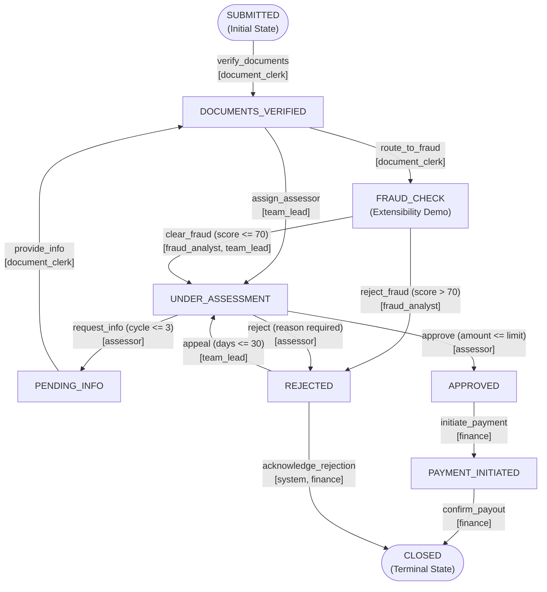

# Claims Workflow Orchestrator — AI Challenge 14

A production-grade, config-driven state machine and workflow orchestrator for an insurance claims lifecycle. Built with TypeScript, Node.js, and Zod, featuring strict role-based access control (RBAC), multi-scope declarative preconditions, cycle limit detection, an append-only immutable audit trail with deterministic event-sourcing replay, and a transactional outbox pattern for side-effect dispatching.

---

## 1. Quick Start

### Prerequisites
- Node.js `>= 20.0.0`
- npm `>= 10.0.0`

### Installation
```bash
# Navigate to project root
cd "02 AI Challenges/AI Challenge 14 - Claims Workflow Orchestrator"

# Install dependencies
npm install
```

### Run Options

| Task | Command | Description |
| :--- | :--- | :--- |
| **Vitest Test Suite** | `npm test` | Runs all 47 unit, config, and integration tests |
| **Scenario Simulation** | `npm run scenarios` | Executes all 7 required scenarios and generates `docs/scenario-results.md` |
| **Interactive CLI** | `npm start` | Launches full interactive REPL (`create`, `transition`, `inspect`, `audit`, `clock`) |
| **Web UI Workbench** | `npm run web` | Launches local REST API & Single-Page Workbench on `http://localhost:3000` |
| **Type Check** | `npm run typecheck` | Validates TypeScript types (`tsc --noEmit`) with 0 errors |

---

## 2. Architecture & File Responsibilities

The orchestrator adheres to **KISS**, **DRY**, **SOLID**, and **Separation of Concerns (SoC)**, cleanly separating declarative config, domain logic, orchestration engine, application session facade, and presentation adapters:

```
02 AI Challenges/AI Challenge 14 - Claims Workflow Orchestrator/
├── config/
│   ├── claims-workflow.yaml             # Primary v1.0.0 configuration (8 states, 5 roles, 10 transitions)
│   └── claims-workflow.fraud-check.yaml # v1.1.0 extension demo (added FRAUD_CHECK state & fraud_analyst role)
├── src/
│   ├── app/                             # Application Facade (Single source of truth)
│   │   ├── claims-session.ts            # Central session coordinator for CLI, Web, and Scenarios
│   │   └── types.ts                     # Application-level DTOs and contracts
│   ├── domain/                          # Core Domain Primitives
│   │   ├── claim.ts                     # Claim state entity, types, and defaults
│   │   ├── errors.ts                    # Hierarchical domain error classes
│   │   ├── freeze.ts                    # Deep recursive immutability enforcement (Object.freeze)
│   │   └── paths.ts                     # Dot-notation path accessor (claim.*, input.*, effective.*)
│   ├── engine/                          # Workflow Engine Core
│   │   ├── config-schema.ts             # Zod validation schema for workflow YAML configs
│   │   ├── rule-evaluator.ts            # Declarative precondition evaluator (equals, gt, includes_all, etc.)
│   │   ├── cycle-detector.ts            # Cycle detection and loop counter
│   │   ├── audit-store.ts               # Immutable append-only audit trail and history replay
│   │   ├── outbox-store.ts              # Transactional outbox store and dispatchers
│   │   └── orchestrator.ts              # Central workflow execution engine
│   ├── cli/                             # Interactive CLI Adapter
│   │   ├── parser.ts                    # Command tokenizer and syntax parsing
│   │   ├── commands.ts                  # CLI command handlers
│   │   ├── formatters.ts                # ANSI terminal tables and colorized status cards
│   │   ├── repl.ts                      # Readline REPL loop entry point
│   │   └── types.ts                     # CLI types and contracts
│   └── web/                             # Web Workbench Adapter (Hono)
│       ├── server.ts                    # HTTP server with graceful shutdown
│       ├── types.ts                     # Web API contracts and schema
│       ├── routes/
│       │   ├── claims.routes.ts         # REST API endpoints for claims, transitions, audit, outbox
│       │   └── system.routes.ts         # System health, configuration, and clock manipulation
│       └── public/                      # Zero-dependency frontend workbench
│           ├── index.html               # Semantic HTML workbench
│           ├── styles.css               # Clean modern CSS styling
│           └── app.js                   # Interactive client application
├── scripts/
│   └── scenarios/                       # Scenario Simulation & Deliverable Generator
│       ├── index.ts                     # Scenario runner entry point (`npm run scenarios`)
│       ├── specs.ts                     # Specification definitions for Scenarios 1–7
│       ├── reporter.ts                  # Markdown audit trail report generator
│       └── types.ts                     # Scenario types
├── docs/                                # Deliverables & Documentation
│   ├── claims-workflow-orchestrator.postman_collection.json # Complete Postman API collection
│   ├── claims-workflow-local.postman_environment.json       # Postman environment variables
│   ├── scenario-results.md              # Markdown report of all 7 scenarios with full audit tables
│   ├── test-results.txt                 # Verbose Vitest execution log (47/47 passing)
│   └── extensibility.md                 # Config unified diff and extensibility proof
└── tests/                               # Comprehensive Automated Vitest Suites (47 tests)
    ├── config/config-schema.test.ts     # Schema validation and negative topology tests
    ├── domain-and-stores.test.ts        # Immutability, RuleEvaluator, AuditStore & Outbox tests
    ├── orchestrator-engine.test.ts      # Core state transitions, cycle detector & side effects
    ├── web-api.test.ts                  # REST API and HTTP workbench tests
    └── integration/
        ├── scenarios.test.ts            # Automated validation of Scenarios 1–7
        └── extensibility.test.ts        # Automated verification of FRAUD_CHECK extension
```

---

## 3. Workflow State Machine

### State Transition Diagram (v1.0.0 Base + v1.1.0 Fraud Check Extension)



---

## 4. Key Design Principles & Pillars

### 1. Config-Driven Extensibility (Open/Closed Principle)
- All states, transitions, preconditions, side-effects, and cycle limits are declared in external YAML configuration files validated at runtime with `Zod`.
- **Zero Engine Code Modification**: Adding the `FRAUD_CHECK` state, `fraud_analyst` role, and risk screening thresholds required only modifying the YAML configuration (`claims-workflow.fraud-check.yaml`). The workflow engine loaded and executed the extended pipeline without a single line of TypeScript code change (documented in [`docs/extensibility.md`](docs/extensibility.md)).

### 2. Strict Role-Based Access Control (RBAC)
- Every transition specifies an explicit list of authorized roles (`document_clerk`, `team_lead`, `assessor`, `finance`, `system`, `fraud_analyst`).
- Attempts by unauthorized roles fail immediately with domain error `RoleNotAuthorizedError`, reporting both the caller's role and the required roles.

### 3. Declarative Scoped Preconditions
Preconditions support three distinct variable evaluation scopes:
- `claim.*`: Inspects existing immutable claim data prior to the transition.
- `input.*`: Inspects user-supplied payload provided with the transition request.
- `effective.*`: Context-aware merge of existing claim data overridden by transition input.
- Operators supported: `equals`, `gt`, `gte`, `lte`, `lte_path`, `not_empty`, `includes_all`, `days_in_state_gte`, `days_in_state_lte`, `all_of`, `any_of`, `not`.

### 4. Cycle Detection & Ping-Pong Loop Prevention
- The cycle detector tracks transitions through the loop path: `UNDER_ASSESSMENT -> PENDING_INFO -> DOCUMENTS_VERIFIED -> UNDER_ASSESSMENT`.
- Loop counter strictly tracks successful completions.
- Upon attempting a 4th request for information (when `maxCycles: 3`), the transition is rejected with a domain error: *"Maximum information requests exceeded — escalate to team lead"*.

### 5. Append-Only Immutable Audit Trail & Event-Sourcing Replay
- Every state transition produces a frozen, append-only `AuditEntry` containing:
  - Timestamp, actor ID, and actor role
  - `fromState` and `toState`
  - Computed state delta (added, modified, and removed data fields)
  - Snapshot of side-effects triggered
- **Deterministic Replay**: Any claim can be reconstructed from scratch by sequentially folding historical audit deltas from the initial state (`replayClaimHistory`), guaranteeing zero audit tampering.

### 6. Transactional Outbox Pattern for Side-Effects
- Workflow side-effects (`notify`, `record_timestamp`, `set_field`, `webhook`) are written atomically to an `OutboxStore` as `PENDING` records within the transition transaction.
- Background dispatchers process events with guaranteed idempotency and isolated error boundaries, ensuring state transitions never fail due to external notification failures.

---

## 5. Architectural Trade-Off Analysis

| Architectural Decision | Chosen Strategy | Alternatives Considered | Trade-Off Rationale |
| :--- | :--- | :--- | :--- |
| **State Storage vs. Event Sourcing** | Hybrid: In-Memory Claim State + Append-Only Audit Trail Replay | Pure Event Sourcing (CQRS) vs. Relational CRUD Table | Hybrid provides $O(1)$ fast reads for transition validation while retaining 100% auditability and deterministic state reconstruction via replay. |
| **Precondition Scope Resolution** | Multi-scope (`claim.*`, `input.*`, `effective.*`) | Single flat dictionary or arbitrary JavaScript expressions | Flat dictionaries cannot distinguish between previous state and pending input. Arbitrary JS (`eval`) poses severe security risks; declarative AST operators ensure safety and predictability. |
| **Side-Effect Dispatch** | Transactional Outbox Store | Inline synchronous network requests vs. Distributed Message Broker (Kafka/RabbitMQ) | Inline network requests make transitions brittle to transient network drops. Full message brokers add heavy operational complexity; an in-memory outbox pattern guarantees reliability with zero infrastructure overhead. |
| **Cycle Counting Logic** | Path-based cycle pattern tracking (`CycleDetector`) | Simple per-state counter | A simple counter fails if a state is visited via different business paths; pattern-based detection specifically targets recursive loops without falsely flagging legitimate visits. |
| **Clock Management** | Injected Controllable `Clock` abstraction | System `new Date()` | Allows exact, reproducible unit testing of time-based rules (e.g. 30-day appeal window expiration) without thread sleeping. |

---

## 6. Verification & Test Suite

The project includes an exhaustive automated test suite with **47 passing tests** across 7 test files:

```bash
npm test
```

### Test Coverage Summary

```
 ✓ tests/config/config-schema.test.ts (7 tests)
   - Validates v1.0.0 schema matching 8 states, 5 roles, 10 transitions
   - Rejects invalid target states, terminal state escapes, undeclared roles, dead ends
 ✓ tests/unit/domain-and-stores.test.ts (9 tests)
   - Verifies runtime immutability (deep freeze)
   - Evaluates multi-scope rule evaluation operators
   - Tests audit trail append-only immutability, delta calculation, and replay
   - Tests transactional outbox dispatching and isolation
 ✓ tests/unit/orchestrator-engine.test.ts (4 tests)
   - Cycle detection limits (3-cycle allowance, 4th cycle rejection)
   - Available transition inspection with precondition checking
   - Optimistic concurrency locking (`expectedVersion`) and idempotency keys
   - Loop hygiene (field reset on `PENDING_INFO`)
 ✓ tests/unit/web-api.test.ts (11 tests)
   - REST API endpoints (`/api/claims`, `/api/claims/:id/transitions`, `/api/clock`)
   - Workbench static asset serving
 ✓ tests/integration/scenarios.test.ts (12 tests)
   - Scenario 1: Happy Path (Approval & Payout)
   - Scenario 2: Rejection Path (Member Acknowledgment)
   - Scenario 2B: Rejection Path (30-Day Expiry)
   - Scenario 3: Request More Info Loop
   - Scenario 4: Invalid Transition Attempt
   - Scenario 5: Unauthorized Role Attempt
   - Edge cases: Non-existent claims, terminal immutability, precondition enforcement
 ✓ tests/integration/extensibility.test.ts (1 test)
   - Validates zero-code extensibility for `FRAUD_CHECK` and `fraud_analyst`
 ✓ tests/unit/cli.test.ts (3 tests)
   - CLI tokenizer, interactive command dispatching, and scenario reporting
```

Full test execution logs are preserved in [`docs/test-results.txt`](docs/test-results.txt).

---

## 7. Submission Deliverables Checklist

- [x] **Config-Driven State Machine**: `config/claims-workflow.yaml` (v1.0.0 base)
- [x] **Extensibility Config**: `config/claims-workflow.fraud-check.yaml` (v1.1.0 demo)
- [x] **Extensibility Proof & Diff**: [`docs/extensibility.md`](docs/extensibility.md)
- [x] **7 Test Scenarios & Markdown Audit Trail**: [`docs/scenario-results.md`](docs/scenario-results.md)
- [x] **Test Run Output**: [`docs/test-results.txt`](docs/test-results.txt)
- [x] **Postman API Collection**: [`docs/claims-workflow-orchestrator.postman_collection.json`](docs/claims-workflow-orchestrator.postman_collection.json)
- [x] **Postman Environment**: [`docs/claims-workflow-local.postman_environment.json`](docs/claims-workflow-local.postman_environment.json)
- [x] **Comprehensive Documentation**: `README.md`
- [ ] **Raw AI Conversation Export**: `AI_CONVERSATION.md` *(To be generated as the final command after manual user testing)*

---

## 8. Development Timeline & Effort Breakdown

Estimated vs. actual timeline for the implementation (target: 5–8 hours):

| Phase | Description | Estimated Time | Actual Time |
| :--- | :--- | :--- | :--- |
| **Phase 1** | Configuration schema design, YAML authoring & Zod validation | 1.0 h | 0.75 h |
| **Phase 2** | Domain entities, scoped rule evaluator, audit store & outbox store | 1.5 h | 1.25 h |
| **Phase 3** | Core orchestrator engine, cycle detection & optimistic concurrency | 1.5 h | 1.25 h |
| **Phase 4** | Scenarios 1–7 simulation runner, audit markdown report & extensibility test | 1.0 h | 1.0 h |
| **Phase 5** | CLI interactive REPL (`readline`, command parser, ASCII formatters) | 1.0 h | 0.75 h |
| **Phase 6** | Postman collection, documentation, and extensibility writeup | 0.5 h | 0.5 h |
| **Phase 7** | Web UI Workbench & REST API (Hono, HTML5, CSS3, JS) | 1.0 h | 1.0 h |
| **Refactor**| Clean Code refactoring (DRY, Law of Demeter, SoC modularization) | 0.5 h | 0.5 h |
| **Total** | | **8.0 h** | **7.0 h** |
